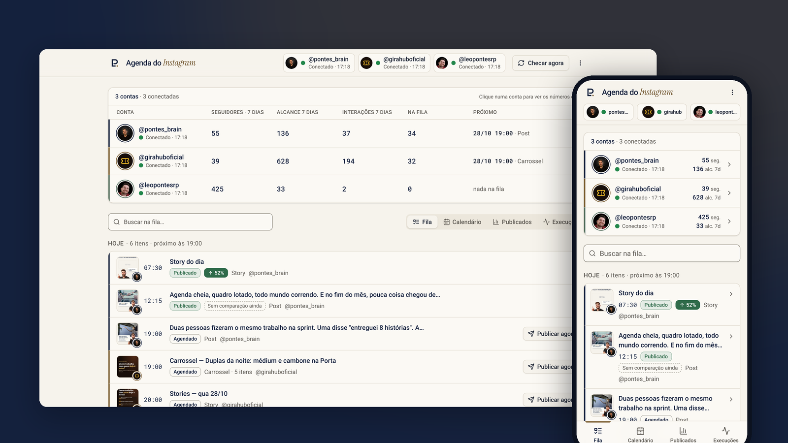
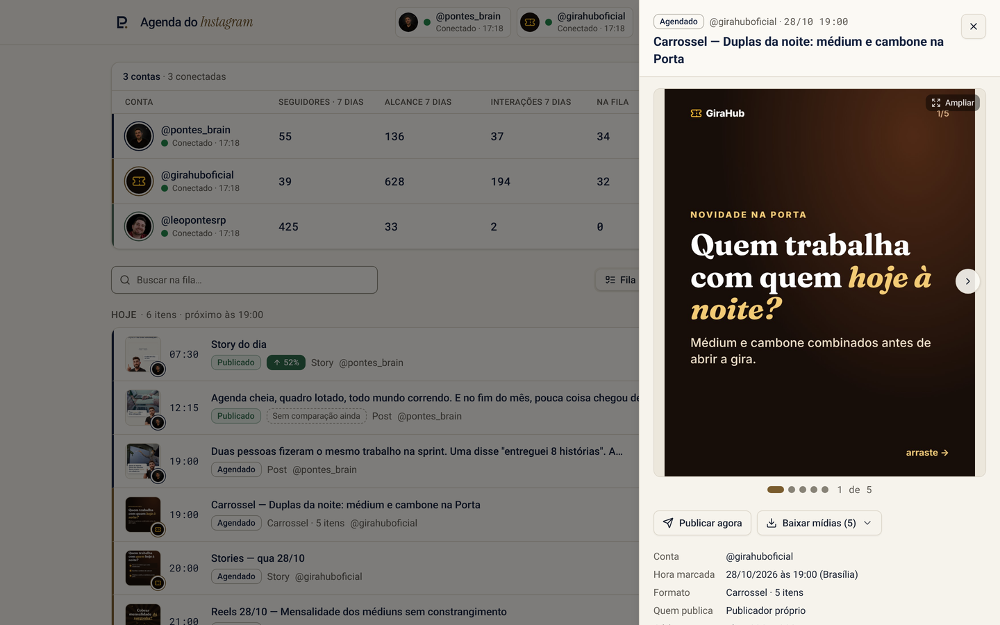
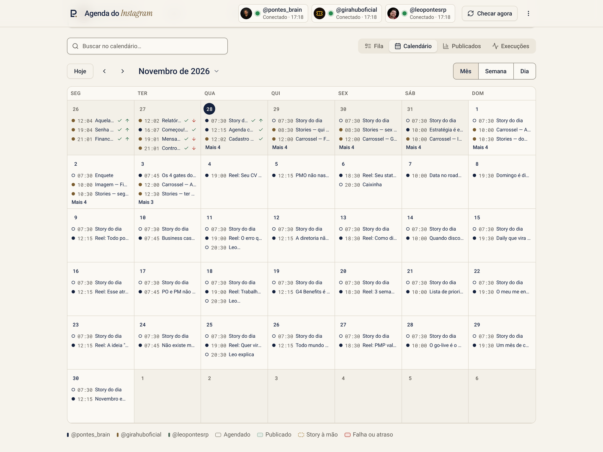
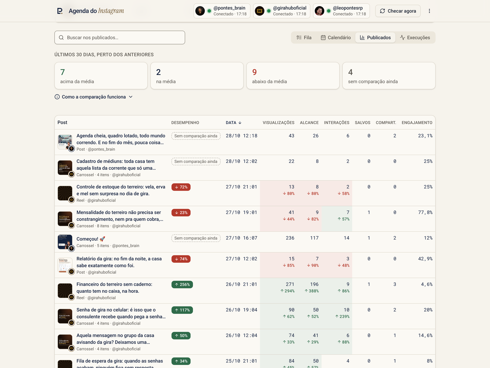
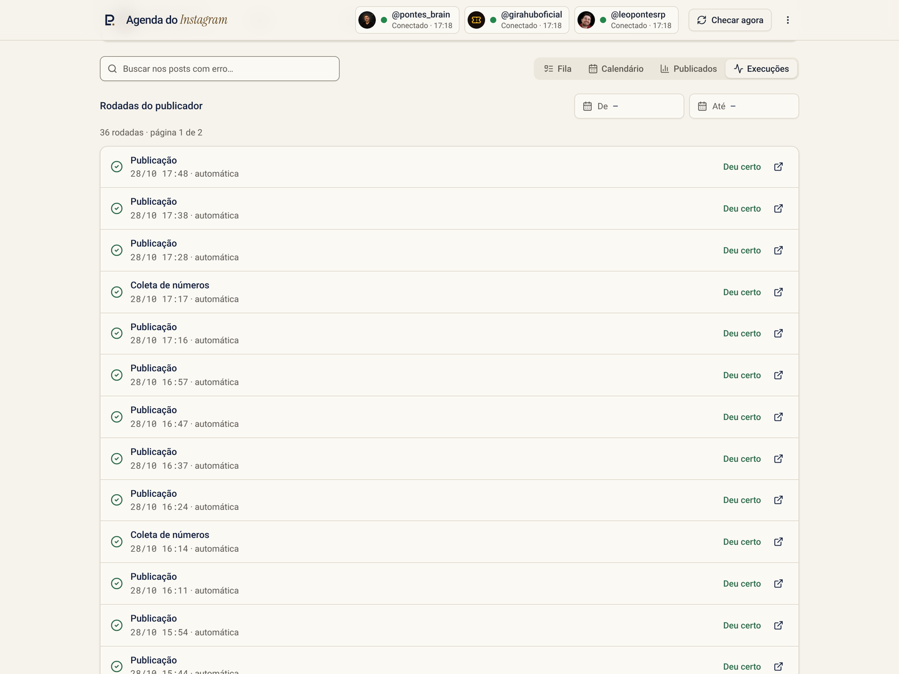
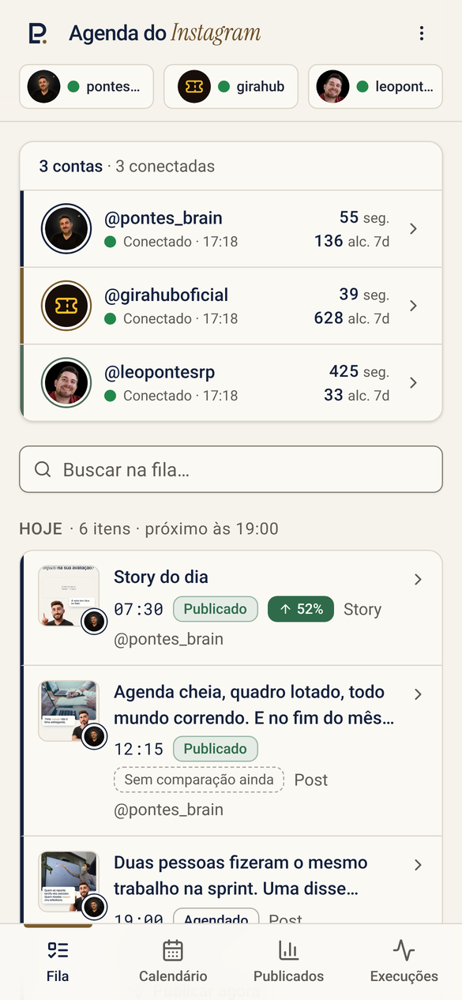
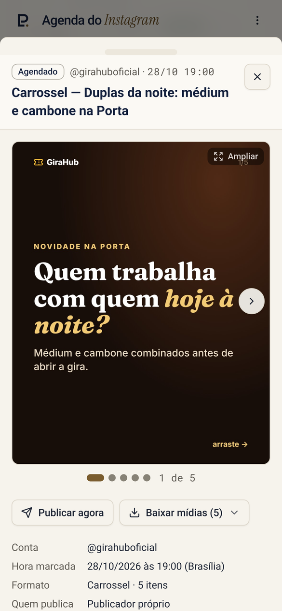
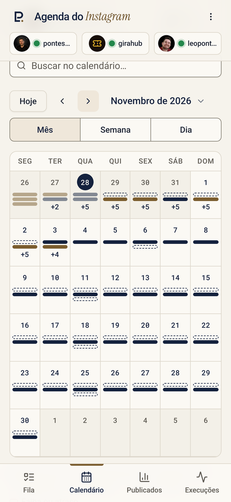
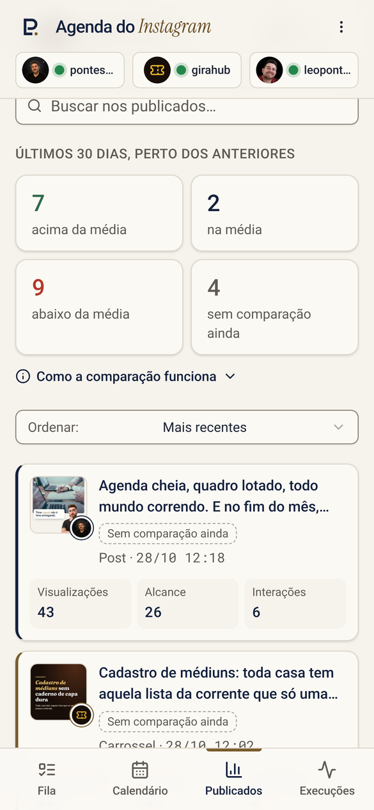
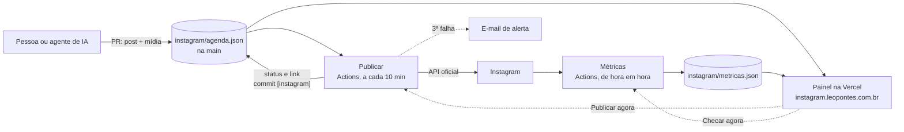

<div align="center">


# Agenda do Instagram

**Agende, publique e acompanhe várias contas do Instagram com um arquivo JSON, um repositório no
GitHub e custo zero.**

Feito para trabalhar junto com agentes de IA: agendar é abrir um PR.

[](https://github.com/leonfpontes/insta_report/actions/workflows/publicar.yml)
[](https://github.com/leonfpontes/insta_report/actions/workflows/metricas.yml)




</div>

## Por que existe

Ferramentas de agendamento cobram por conta, escondem os números atrás de planos e não
conversam com agentes de IA. Aqui a fila inteira é um arquivo, `instagram/agenda.json`. Uma
pessoa ou um agente acrescenta o post e a mídia por PR. O GitHub Actions publica na hora certa
pela API oficial do Instagram, grava o resultado de volta no arquivo e coleta os números de hora
em hora. Um painel com senha mostra tudo, no computador e no celular.

Hoje ele publica **@pontes_brain**, **@girahuboficial** e **@leopontesrp**.

## O que faz

| | |
| --- | --- |
| **Publica sozinho** | Post, carrossel com imagem e vídeo, reel com capa, story e story em vídeo, pela API oficial (login do Instagram). Até 3 tentativas, sem post duplicado |
| **Stories à mão também** | Story com sticker, enquete ou música fica como "postar à mão", com a arte, o texto e as instruções no painel. Um toque em **Já postei** e ele sai da fila |
| **Números de verdade** | Views, alcance, interações, salvos e compartilhamentos de cada post, coletados de hora em hora e guardados como série. Seguidores por dia, resumo de 7 e 28 dias, público |
| **Comparação justa** | Cada post é comparado com a média dos 5 anteriores da mesma conta **na mesma idade**. ▲ acima, ▼ abaixo, sem ruído de número pequeno |
| **Luz de conexão** | Verde ou vermelha ao lado de cada conta: você sabe que um token venceu antes do post falhar |
| **Alerta que explica** | Quando um post não sai, chega um e-mail dizendo o que houve e o que fazer, em português, com o botão para abrir o post |
| **Token que se renova** | Toda segunda o token de 60 dias é renovado e, se mudar, gravado no segredo do repositório |
| **Todas as mídias à mão** | Carrossel com setas, tela cheia e **Baixar mídias** (um arquivo ou `.zip`) em qualquer post |
| **Histórico completo** | Cada mudança de status é um commit. Desfazer é `git revert` |

## O painel

<table>
<tr>
<td width="50%"><br><sub><b>Detalhe do post.</b> Todas as imagens do carrossel, legenda, números, Publicar agora e Baixar mídias.</sub></td>
<td width="50%"><br><sub><b>Calendário.</b> Mês, semana e dia, com a cor de cada conta e o que foi publicado.</sub></td>
</tr>
<tr>
<td><br><sub><b>Publicados.</b> Quantos posts ficaram acima ou abaixo da média e a diferença em cada número.</sub></td>
<td><br><sub><b>Execuções.</b> Cada rodada do publicador e da coleta, com o link para o log.</sub></td>
</tr>
</table>

<p align="center">




</p>

Mais telas e o que cada botão faz em [doc/painel.md](doc/painel.md).

## Como funciona



| Peça | Onde | Custo |
| --- | --- | --- |
| Agenda, mídia e histórico | Repositório GitHub | grátis |
| Publicador, coleta, renovação de token | GitHub Actions | grátis em repositório público |
| Entrega da mídia para o Instagram | jsDelivr, no commit da rodada | grátis |
| Painel e rotas | Vercel Hobby | grátis |
| E-mail de alerta | Resend | grátis até 100 por dia |

Detalhes em [doc/arquitetura.md](doc/arquitetura.md).

## Agendar um post

Acrescente no fim de `posts` em `instagram/agenda.json` e grave a mídia em `instagram/midia/`:

```json
{
  "id": "lp-1104-1900",
  "conta": "leopontesrp",
  "quando": "2026-11-04T19:00:00-03:00",
  "formato": "carrossel",
  "status": "agendado",
  "titulo": "Três erros de quem começa a gerir portfólio",
  "legenda": "Texto completo da legenda.\n\n#portfolio #pmo",
  "midia": ["midia/leopontesrp/lp-1104-1900-01.jpg", "midia/leopontesrp/lp-1104-1900-02.jpg"]
}
```

Abra o PR, faça o merge antes da hora e pronto. O post sai na primeira rodada depois de
`quando`. Formatos aceitos: `post`, `carrossel`, `reel`, `story` e `story-video`. Status ao
criar: `agendado`, ou `manual` para o que vai ser postado à mão.

Tudo sobre o formato em [doc/agenda.md](doc/agenda.md). Para agentes de IA, as regras estão em
[CLAUDE.md](CLAUDE.md).

## Rodar no seu computador

```bash
git clone https://github.com/leonfpontes/insta_report.git && cd insta_report
npm ci
npm run build
npm run local        # http://localhost:3000 · senha: senha-local-123
```

O painel local lê a agenda e as métricas do próprio clone, sem Vercel e sem token. Para mexer na
interface com recarga instantânea, rode `npm run dev` noutro terminal (porta 5173).

```bash
SIMULAR=1 node scripts/publicar.mjs   # mostra o que o publicador postaria agora, sem chamar a API
npm run check                         # sintaxe de scripts, lib e rotas
npm run build                         # tipos e build do painel
```

Mais em [doc/desenvolvimento.md](doc/desenvolvimento.md).

## Colocar no ar

1. **Repositório.** Faça um fork ou copie o repositório. Público, para o Actions ser gratuito.
2. **Conta do Instagram.** Profissional (Criador ou Empresa), ligada a um app da Meta com a API
   com login do Instagram e as permissões `instagram_business_basic`,
   `instagram_business_content_publish` e `instagram_business_manage_insights`. Passo a passo em
   [doc/contas-e-tokens.md](doc/contas-e-tokens.md).
3. **Segredos do GitHub** (Settings → Secrets and variables → Actions):

   | Segredo | Para quê |
   | --- | --- |
   | `IG_TOKEN_<CONTA>` | Token de cada conta. Ex.: `IG_TOKEN_PONTES_BRAIN` |
   | `RESEND_API_KEY`, `ALERTA_EMAIL` | E-mail de alerta |
   | `GH_SECRETS_TOKEN` | Opcional: deixa o token renovado ser gravado sozinho |

4. **Vercel.** Importe o repositório. O `vercel.json` já define build e saída. Variáveis:

   | Variável | Para quê |
   | --- | --- |
   | `PAINEL_SENHA` | Senha do painel, 12 caracteres ou mais |
   | `GITHUB_TOKEN` | Token fino só deste repositório, com Contents e Actions em leitura e escrita |

5. **Testar.** Actions → Publicar → Run workflow com **verificar** marcado. Depois, um post com
   **simular**. Por fim, ponha `"publicador": "proprio"` na conta.

Nunca cole tokens em chat, issue ou arquivo do repositório.

## Documentação

| | |
| --- | --- |
| [Arquitetura](doc/arquitetura.md) | Peças, fluxo de um post, mapa do repositório, limites |
| [Agenda](doc/agenda.md) | Formato completo, status, mídia, checagem antes do PR |
| [Publicador](doc/publicador.md) | Como escolhe, publica, tenta de novo e desiste |
| [Métricas](doc/metricas.md) | O que é coletado e a regra de comparação |
| [Painel](doc/painel.md) | Telas, links diretos, rotas da API, segurança |
| [Alertas](doc/alertas.md) | Quando chega e-mail e o que ele diz |
| [Contas e tokens](doc/contas-e-tokens.md) | Ligar conta, renovação, token recusado |
| [Operação](doc/operacao.md) | Rotina, diagnóstico, comandos úteis |
| [Desenvolvimento](doc/desenvolvimento.md) | Rodar local, deploy, convenções |
| [CLAUDE.md](CLAUDE.md) | Guia para agentes de IA |

## Stack

Node 20 sem dependências nos scripts · GitHub Actions · API do Instagram (graph.instagram.com
v23) · Vercel Functions · React 19, Vite 6, Tailwind 4, shadcn/ui, Recharts · Resend · Paleta
Papel & Marinho, Roboto e o monograma LP.

<div align="center"><sub>Feito por <a href="https://leopontes.com.br">Leonardo Pontes</a>.</sub></div>
