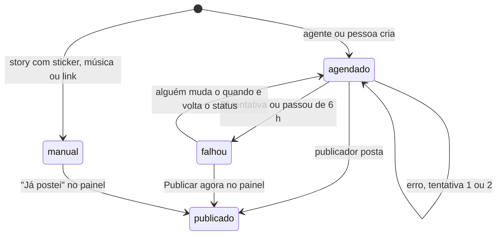

# A agenda (`instagram/agenda.json`)

É a fonte da verdade de tudo o que vai ao ar. O publicador lê, o painel mostra e os agentes
editam. Tem três chaves:

```json
{
  "_leia": "lembrete curto para quem abrir o arquivo",
  "contas": { "...": {} },
  "posts": [ { "...": "..." } ]
}
```

## `contas`

Uma entrada por conta do Instagram. A chave é o nome interno da conta, usado em `posts[].conta`
e no nome do segredo do token.

```json
"contas": {
  "pontes_brain": { "usuario": "@pontes_brain", "publicador": "proprio" },
  "GiraHub":      { "usuario": "@girahuboficial", "publicador": "proprio" },
  "leopontesrp":  { "usuario": "@leopontesrp", "publicador": "proprio" }
}
```

| Campo | Valores | Efeito |
| --- | --- | --- |
| `usuario` | `@arroba` | Nome mostrado no painel e nos e-mails |
| `publicador` | `proprio` | O publicador posta os itens `agendado` desta conta |
| | `pausado` (ou qualquer outro valor) | O publicador ignora a conta; o painel mostra, mas o botão Publicar agora recusa |

O token de cada conta fica no segredo `IG_TOKEN_<CHAVE EM MAIÚSCULAS>`, com tudo que não for
letra ou número trocado por `_`. Exemplo: `GiraHub` → `IG_TOKEN_GIRAHUB`.

## `posts`

```json
{
  "id": "pb-1104-1215",
  "conta": "pontes_brain",
  "quando": "2026-11-04T12:15:00-03:00",
  "formato": "carrossel",
  "status": "agendado",
  "titulo": "Resumo curto para o painel",
  "legenda": "Texto completo da legenda.\n\nCom quebras de linha e #hashtags",
  "midia": [
    "midia/d03-2026-11-04-01.jpg",
    "midia/d03-2026-11-04-02.jpg"
  ],
  "nota": "Opcional: instrução para quem posta à mão"
}
```

### Campos escritos por quem agenda

| Campo | Obrigatório | Regra |
| --- | --- | --- |
| `id` | sim | Único na agenda inteira. Use um prefixo da conta, mês, dia e hora (`pb-1104-1215`). Some um sufixo se houver dois no mesmo horário |
| `conta` | sim | Uma chave de `contas` |
| `quando` | sim | ISO 8601 com o fuso de Brasília: `2026-11-04T12:15:00-03:00` |
| `formato` | sim | `post`, `carrossel`, `reel`, `story` ou `story-video` |
| `status` | sim | `agendado` ou `manual` ao criar |
| `titulo` | não | Resumo de uma linha para o painel e para o e-mail de alerta. Sem ele, o painel usa o começo da legenda |
| `legenda` | não* | Texto do post. *Obrigatório na prática para feed e reel. Em story manual, guarda o texto da arte |
| `midia` | sim | Caminhos relativos a `instagram/`, na ordem em que aparecem |
| `capa` | não | Só para `reel`: imagem JPEG usada como capa |
| `nota` | não | Instruções para a pessoa que vai postar à mão (sticker, música, link) |
| `colaboradores` | não | Collab: lista de até 3 usuários (sem @). Vale para post, carrossel e reel. O post só aparece no perfil da pessoa depois que ela aceita o convite |
| `marcacoes` | não | Marca pessoas nas fotos: lista de `{ "usuario": "camilacgod", "foto": 1, "x": 0.4, "y": 0.5 }`. `foto` é a posição na `midia` (começa em 1, padrão 1); `x` e `y` vão de 0 a 1 a partir do canto de cima à esquerda (padrão 0.5). Só imagens de post e carrossel. Se a API recusar uma marcação, o post sai sem ela e o log da rodada diz qual foi |

### Campos escritos pelo publicador

Não preencha estes campos ao criar um post.

| Campo | Quando aparece |
| --- | --- |
| `status: "publicado"` | Saiu no Instagram, ou alguém marcou "Já postei" no painel |
| `status: "falhou"` | 3 tentativas com erro, ou passou de 6 h da hora marcada |
| `link` | Permalink do post publicado |
| `midiaId` | Id da mídia no Instagram |
| `publicadoEm` | Hora real da publicação |
| `erro` | Última mensagem de erro da API |
| `tentativas` | Quantas vezes já tentou |

## Formatos

| `formato` | `midia` | Proporção recomendada | Observações |
| --- | --- | --- | --- |
| `post` | 1 JPEG | 4:5, 1080×1350 | Aceita de 4:5 até 1,91:1 |
| `carrossel` | 2 a 10 itens, JPEG ou MP4 | 4:5 em todos | Todos os itens com a mesma proporção |
| `reel` | 1 MP4 (H.264, AAC) | 9:16, 1080×1920 | `capa` opcional |
| `story` | 1 JPEG | 9:16, 1080×1920 | Sem sticker, link ou música pela API |
| `story-video` | 1 MP4 | 9:16, 1080×1920 | Até 60 s |

PNG não publica: a API só aceita JPEG para imagem.

## Status



## Mídia

- Grave em `instagram/midia/`. Uma subpasta por conta ou campanha ajuda a achar depois, por
  exemplo `instagram/midia/leopontesrp/` ou `instagram/midia/stories/`.
- O arquivo precisa estar na `main` antes do horário do post. O Instagram baixa a mídia do
  jsDelivr no commit da rodada.
- Nomes sem espaço nem acento evitam surpresa em URL.
- Vídeo de story vai sem áudio quando a música vai ser posta à mão no app.
- O painel gera miniaturas pela otimização de imagem da Vercel. Não precisa criar miniatura.

## Conferir antes do PR

```bash
node -e "JSON.parse(require('fs').readFileSync('instagram/agenda.json'))"   # JSON válido
npm run check                                                               # sintaxe dos scripts
```

Ids repetidos, contas que não existem e mídia faltando não quebram o JSON, mas quebram a
publicação. Este trecho confere os três:

```bash
node -e '
const fs=require("fs"); const a=JSON.parse(fs.readFileSync("instagram/agenda.json"));
const ids=new Set(); let ok=true;
for (const p of a.posts) {
  if (ids.has(p.id)) { console.log("id repetido", p.id); ok=false } ids.add(p.id);
  if (!a.contas[p.conta]) { console.log("conta desconhecida", p.id, p.conta); ok=false }
  for (const m of [...(p.midia||[]), ...(p.capa?[p.capa]:[])])
    if (!fs.existsSync("instagram/"+m)) { console.log("mídia faltando", p.id, m); ok=false }
  if (!/[+-]\d\d:\d\d$/.test(p.quando)) { console.log("quando sem fuso", p.id); ok=false }
}
console.log(ok ? "agenda ok" : "corrija os itens acima"); process.exit(ok?0:1)'
```
