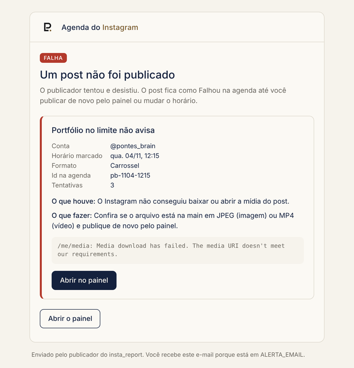

# Alertas por e-mail

`scripts/alerta.mjs` monta e envia os e-mails pelo [Resend](https://resend.com), do remetente
`Agenda Instagram <alertas@leopontes.com.br>` para o endereço do segredo `ALERTA_EMAIL`.

## Quando chega

| Situação | Quem manda | Assunto |
| --- | --- | --- |
| Um post falhou 3 vezes | Publicar | `Instagram: não saiu "<título>"` |
| Vários posts falharam na mesma rodada | Publicar | `Instagram: N posts não saíram` |
| Um post passou de 6 h da hora marcada sem sair | Publicar | igual aos acima |
| Falta o segredo do token de uma conta com post na hora | Publicar | igual aos acima |
| A renovação semanal do token não deu certo | Renovar token | `Instagram: token precisa de atenção` |
| Teste pedido no Run workflow | Publicar (`testar_alerta`) | `Instagram: alerta de teste` |

## O que o e-mail traz

Para cada post: conta, horário marcado, formato, id, número de tentativas, **o que houve** em
português, **o que fazer**, o erro técnico original e um botão que abre o post no painel
(`https://instagram.leopontes.com.br/#post-<id>`). No fim, links para o painel e para o log da
rodada no GitHub. Vai em HTML (tabelas com estilo inline, paleta Papel & Marinho) e em texto puro.

## Tradução dos erros

A função `explicar()` reconhece estes casos pela mensagem da API:

| Erro contém | Motivo mostrado |
| --- | --- |
| `passou mais de` | O post não saiu na hora e foi segurado |
| `falta o segredo` | Falta o token da conta nos segredos |
| `session has expired`, `access token`, código 190 | Token vencido ou revogado |
| `aspect ratio` | Proporção da mídia recusada |
| `media download`, `image_url`, `video_url`, `format` | O Instagram não conseguiu baixar ou abrir a mídia |
| `não ficou pronto`, `expired`, `container` | O vídeo não terminou de processar |
| `limit`, `rate`, `too many` | Limite da API (100 posts por dia) |
| `timeout`, `fetch failed`, `network` | Conexão caiu |

Qualquer outro erro sai como "erro que eu não reconheço", com o detalhe técnico. Para ensinar um
caso novo, acrescente uma linha em `explicar()`.

## Configurar

1. No Resend, verifique o domínio do remetente (hoje `leopontes.com.br`).
2. Crie uma chave de API com permissão de envio e grave no segredo `RESEND_API_KEY`.
3. Grave o destino no segredo `ALERTA_EMAIL`.
4. Teste: Actions → Publicar → Run workflow → marque **testar_alerta**.

O plano gratuito do Resend dá 100 e-mails por dia, divididos com os outros usos do mesmo domínio.
Sem `RESEND_API_KEY` ou `ALERTA_EMAIL`, nada é enviado: o script só escreve o assunto no log.

Para trocar o remetente, edite `REMETENTE` no topo de `scripts/alerta.mjs`. O endereço do painel
nos links vem da variável `PAINEL_URL` (padrão `https://instagram.leopontes.com.br`).
