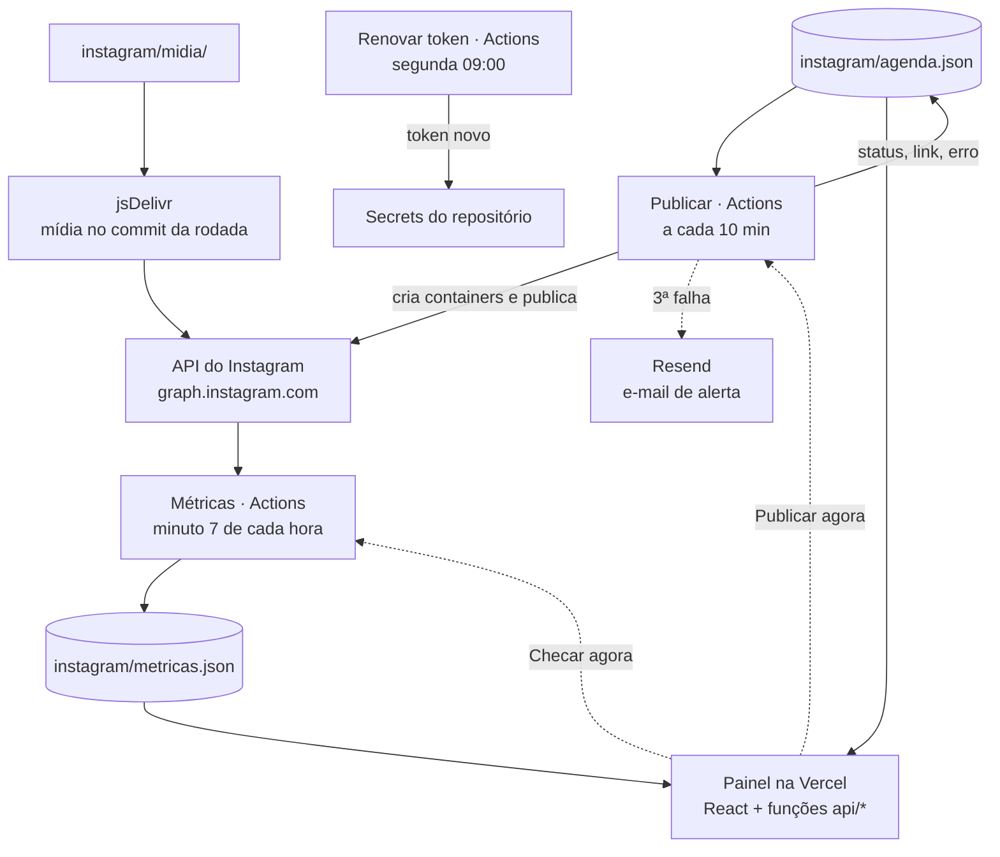

# Arquitetura

O insta_report não tem banco de dados nem servidor próprio. O estado inteiro mora em dois
arquivos JSON na branch `main` deste repositório, e três peças gratuitas trabalham em volta
deles:

| Peça | Onde roda | O que faz |
| --- | --- | --- |
| Publicador (`scripts/publicar.mjs`) | GitHub Actions, a cada 10 min | Publica pela API do Instagram o que chegou na hora e grava o resultado na agenda |
| Coletor de métricas (`scripts/metricas.mjs`) | GitHub Actions, de hora em hora | Lê perfil, posts, stories e insights de cada conta e grava `instagram/metricas.json` |
| Renovação de token (`scripts/renovar-token.mjs`) | GitHub Actions, toda segunda | Renova o token de 60 dias de cada conta |
| Painel (`src/` + `api/` + `lib/painel.mjs`) | Vercel | Mostra fila, calendário, publicados e execuções; tem os botões de ação |
| Alertas (`scripts/alerta.mjs`) | Dentro dos workflows | Manda e-mail pelo Resend quando algo falha |



## Fluxo de um post

1. Alguém (pessoa ou agente de IA) acrescenta o post em `instagram/agenda.json` e a mídia em
   `instagram/midia/`, por PR na `main`.
2. Na primeira rodada do workflow Publicar depois de `quando`, o script monta os containers na
   API do Instagram. A URL de cada mídia aponta para o jsDelivr no SHA exato do commit da rodada.
3. Quando o container fica `FINISHED`, o script chama `media_publish`, busca o `permalink` e grava
   na agenda `status: "publicado"`, `link`, `midiaId` e `publicadoEm`.
4. O passo "Gravar o resultado na agenda" faz o commit `[instagram] atualiza status da agenda`
   direto na `main`.
5. Na próxima rodada de Métricas, o post aparece em `metricas.json` com views, alcance e
   interações, e o painel passa a compará-lo com os anteriores.

## Por que assim

- **Grátis e sem servidor.** Actions agenda, Vercel serve, jsDelivr entrega mídia, Resend manda
  e-mail. Nada fica ligado esperando.
- **Git é o banco de dados.** Cada mudança de status é um commit, então o histórico completo de
  tudo o que foi agendado, publicado ou falhou está no `git log`. Desfazer é `git revert`.
- **Agentes de IA trabalham por PR.** Agendar é editar um JSON e abrir um PR. Não existe tela de
  cadastro nem API própria para aprender. Veja [CLAUDE.md](../CLAUDE.md).
- **A Vercel não reconstrói por causa dos robôs.** O `ignoreCommand` de `vercel.json` pula o
  deploy quando o commit só mexe em `instagram/`.

## Mapa do repositório

```
.github/workflows/   publicar.yml · metricas.yml · renovar-token.yml
api/                 funções da Vercel (rotas /api/*); _lib.js é comum e não vira rota
doc/                 esta documentação e as imagens do README
instagram/
  agenda.json        a fila de todas as contas (fonte da verdade)
  metricas.json      números coletados (escrito só pelo robô)
  midia/             imagens JPEG e vídeos MP4 dos posts
  perfil/            fotos de perfil baixadas pelo coletor
lib/painel.mjs       transforma agenda + métricas + rodadas no JSON do painel
public/              favicon, logo do e-mail, robots.txt
scripts/             publicador, coletor, renovação, alerta e o painel local
src/                 interface React + Vite + Tailwind + shadcn/ui
vercel.json          build, otimização de imagem, cabeçalhos de segurança
```

## Limites conhecidos

- O agendamento do GitHub Actions pode atrasar alguns minutos em horário de pico. O post sai na
  primeira rodada que conseguir, até 6 horas depois da hora marcada.
- A API do Instagram não publica stickers, enquetes, links nem música em stories. Esses ficam
  com `status: "manual"`.
- A cota da API é de 100 publicações por conta a cada 24 horas.
- Posts feitos antes de uma conta virar profissional não têm insights.
- O raw do GitHub tem cache de alguns minutos. O painel pode levar até 5 minutos para mostrar uma
  mudança recém-gravada.
