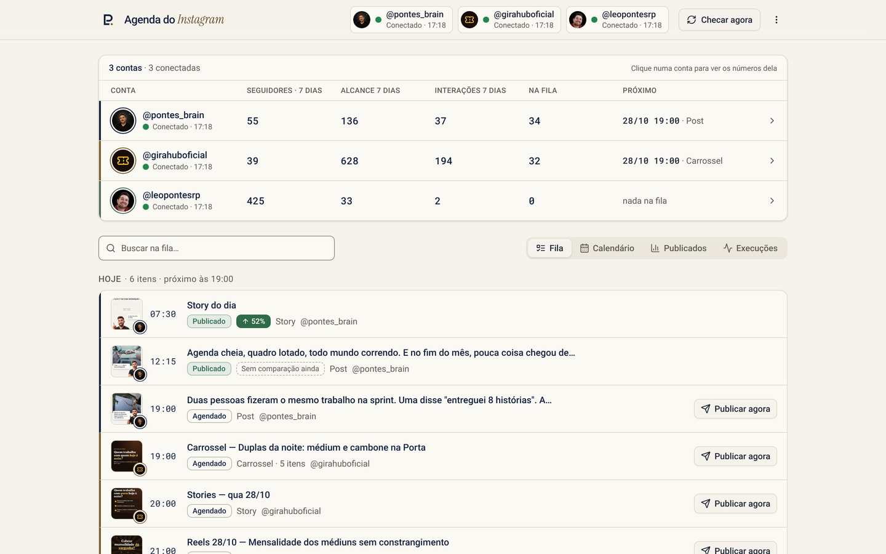
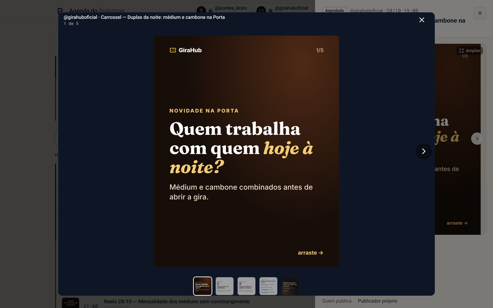
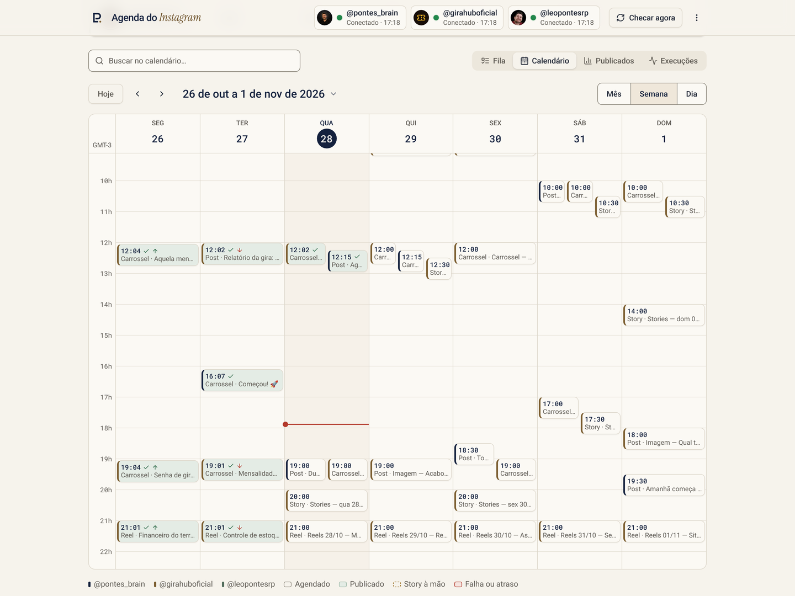

# Painel

O painel fica em **https://instagram.leopontes.com.br**, atrás de senha. É uma aplicação React
(Vite, Tailwind 4, shadcn/ui) servida pela Vercel a partir de `dist/`, com as rotas de `api/`
como funções da Vercel.

## Telas

### Resumo das contas e Fila



- **Cabeçalho:** uma pílula por conta com a foto, a luz de conexão (verde = token aceito na
  última coleta) e a hora da checagem. Tocar numa conta filtra o painel por ela. **Checar agora**
  dispara a coleta de métricas fora de hora.
- **Resumo:** seguidores, alcance e interações dos últimos 7 dias, quantos itens estão na fila e
  o próximo horário de cada conta.
- **Fila:** os próximos dias, agrupados por dia. Cada linha mostra miniatura, hora, título,
  status, formato e conta. Posts publicados ganham a seta de desempenho (▲ 52%, ▼ 72%).
  **Publicar agora** aparece para o que sai nas próximas 24 horas.

### Detalhe do post e mídias


Abre ao tocar em qualquer post, da fila, do calendário ou dos publicados. Mostra todas as
imagens do carrossel com setas e pontos, a legenda completa, a nota para quem posta à mão, os
números e a comparação com os anteriores. **Baixar mídias** baixa um arquivo por vez ou tudo num
`.zip` montado no navegador (`fflate`). **Ampliar** abre a mídia em tela cheia:



Para stories com `status: "manual"`, o detalhe traz a arte, o texto e as instruções do sticker,
e o botão **Já postei**, que grava `publicado` na agenda (`api/manual.js`). Mesmo sem o toque,
o painel mostra o story manual como publicado quando a coleta acha o story do dia no perfil.

### Calendário

| Semana | Mês |
| --- | --- |
|  |  |

Visões de **Mês**, **Semana** e **Dia**, com a cor de cada conta, a linha vermelha da hora atual
e marcas de publicado (✓), acima (▲) ou abaixo (▼) da média.

### Publicados


Os últimos 30 dias de cada conta, com contagem de posts acima, na média e abaixo da média, e a
tabela de views, alcance, interações, salvos, compartilhamentos e engajamento. As células
coloridas mostram a diferença para a média dos 5 posts anteriores na mesma idade. Os detalhes da
regra estão em [metricas.md](metricas.md#comparação-acima-ou-abaixo-da-média).

### Execuções


Cada rodada dos workflows (Publicação, Coleta de números, Renovação de token), com o resultado e
o link para o log no GitHub. Filtra por data e pagina de 20 em 20 (`api/execucoes.js`).

### Pedidos

Onde o Leonardo pede posts ao Claude. No topo, **Esperando você**: propostas prontas para aprovar e
dúvidas do Claude. Depois o quadro **Novo pedido** (conta, texto, fotos e vídeos, formato e
horário), **Em andamento** e, recolhidos, os **Encerrados**. A proposta abre como no feed, com a
hora e a legenda editáveis, e os botões **Aprovar e agendar** e **Pedir ajuste**. O selo bronze na
aba conta o que espera o Leonardo. Formato, status e o trabalho do Claude: [pedidos.md](pedidos.md).

### No celular

| Fila | Detalhe | Calendário | Publicados |
| --- | --- | --- | --- |
|  |  |  |  |

No celular as abas ficam presas embaixo, ao alcance do polegar, o detalhe abre como gaveta e a
tabela de publicados vira cartões.

## Links diretos

| Endereço | Abre |
| --- | --- |
| `/#fila`, `/#calendario`, `/#publicados`, `/#execucoes` | A visão |
| `/#post-<id>` | O detalhe de um post da agenda (é o link do e-mail de alerta) |
| `/#pedidos`, `/#pedido-<id>` | A aba Pedidos, ou um pedido aberto |

## Rotas da API

Todas respondem JSON com `Cache-Control: no-store`. As de ação exigem `POST`, a sessão e o
cabeçalho `X-Painel: 1`, que um formulário de outro site não consegue mandar.

| Rota | Método | O que faz |
| --- | --- | --- |
| `/api/entrar` | POST `{senha}` | Confere `PAINEL_SENHA` e grava o cookie `sessao` (HttpOnly, Secure, SameSite=Strict, 30 dias). Senha errada espera 1,2 s |
| `/api/sair` | POST | Apaga o cookie |
| `/api/dados` | GET | Lê `agenda.json`, `metricas.json`, `pedidos.json` e as 30 últimas rodadas no GitHub e devolve o JSON montado por `lib/painel.mjs` |
| `/api/execucoes` | GET `?pagina=&de=&ate=` | Rodadas dos workflows, 20 por página, com filtro de data (AAAA-MM-DD, horário de Brasília) |
| `/api/publicar` | POST `{id}` | Dispara o workflow Publicar com `post=<id>`. Só para `agendado` ou `falhou` de conta `proprio` |
| `/api/manual` | POST `{id}` | Marca um story `manual` como `publicado` na agenda. Relê e tenta de novo se a agenda mudou no meio |
| `/api/metricas` | POST | Dispara o workflow Métricas |
| `/api/pedidos` | POST `{acao, id, …}` | Cria, comenta, aprova ou recusa um pedido de publicação ([pedidos.md](pedidos.md#rotas)) |
| `/api/anexo` | POST `{pedido, nome, parte, total, dados}` | Grava uma parte de anexo de até 2,8 MB em `instagram/pedidos/<pedido>/` |

## O que `lib/painel.mjs` entrega

`montar()` junta tudo num único JSON para o navegador:

| Chave | Conteúdo |
| --- | --- |
| `agenda` | `contas` e os posts só com os campos que o painel usa, mais `itens` (quantidade de mídias) |
| `metricas` | Por conta: perfil, resumo, posts e stories com `serie` compacta, histórico, conexão |
| `imagens` | Miniaturas por id (`/_vercel/image?url=…&w=640`), incluindo fotos de perfil e posts do Instagram (`ig:<id>`) |
| `galeria` | Todas as mídias de cada carrossel ou vídeo, em 1080 px |
| `arquivos` | URLs dos originais para o botão Baixar mídias |
| `execucoes` | As últimas rodadas no formato `{id, quando, evento, job, resultado, link}` |

Imagens da agenda passam pela otimização de imagem da Vercel a partir do raw do GitHub; vídeos
vêm do jsDelivr em `@main`.

## Segurança

- Sem senha configurada (ou com menos de 12 caracteres), ninguém entra.
- A chave que assina a sessão é derivada da senha: trocar `PAINEL_SENHA` derruba todas as
  sessões abertas.
- `GITHUB_TOKEN` da Vercel é um token fino só deste repositório, com Contents e Actions.
- `vercel.json` manda `X-Frame-Options: DENY`, `nosniff`, `Referrer-Policy: same-origin` e
  `X-Robots-Tag: noindex`.

## Código da interface

```
src/
  App.tsx              estado, carga a cada 2 min, roteamento por hash
  lib/model.ts         regras: filas, status efetivo, comparação com a média
  lib/api.ts           chamadas às rotas
  components/
    header.tsx         marca, contas e Checar agora
    accounts.tsx       resumo das contas
    nav.tsx            abas, barra de baixo do celular e busca
    views/             fila · calendario · publicados · execucoes
    detail.tsx         gaveta ou diálogo do post
    gallery.tsx        carrossel do detalhe
    lightbox.tsx       tela cheia
    downloads.tsx      Baixar mídias (um arquivo ou .zip)
    ui/                componentes shadcn/ui
  index.css            tema Papel & Marinho (tokens) e fontes
```

A identidade visual segue a paleta **Papel & Marinho** (`--background #f6f3ec`, `--primary
#14213d`, `--bronze #7a5c2e`), Roboto no texto, Roboto Mono nos números, Instrument Serif no
destaque e o monograma LP. Os tokens estão em `src/index.css`.
