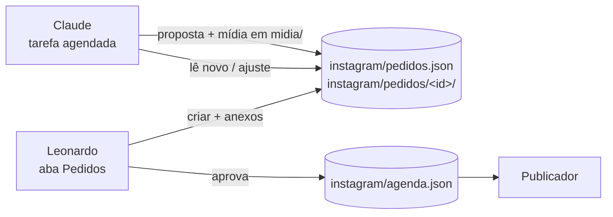

# Pedidos de publicação

O Leonardo abre um pedido na aba **Pedidos** do painel: escolhe a conta, escreve o que quer e,
se quiser, anexa fotos e vídeos. Um Claude lê o pedido, produz o post e grava uma **proposta** no
próprio pedido. O Leonardo vê a proposta no painel, pode mudar a hora e a legenda, e aprova, pede
ajuste ou recusa. Aprovar copia os posts para o fim de `instagram/agenda.json`, e daí em diante é o
publicador de sempre.



## Arquivos

| Caminho | O que é | Quem escreve |
| --- | --- | --- |
| `instagram/pedidos.json` | A lista de pedidos, com a conversa e a proposta | Painel (`api/pedidos.js`) e o Claude |
| `instagram/pedidos/<id>/` | Os anexos do Leonardo, como chegaram | Painel (`api/anexo.js`) |
| `instagram/midia/<pasta-da-conta>/` | A mídia pronta de cada post proposto | O Claude |

Arquivo acima de 2,8 MB chega em partes (`02-video.mov.parte01`, `.parte02`…), porque a Vercel
recusa corpo acima de 4,5 MB. Para juntar:

```bash
cat instagram/pedidos/<id>/02-video.mov.parte* > /tmp/02-video.mov
```

Fotos chegam reduzidas a 2160 px no lado maior, em JPEG. HEIC que o navegador não abriu chega como
veio.

## Um pedido

```json
{
  "id": "pd-20261029-084416",
  "criadoEm": "2026-10-29T11:44:17.372Z",
  "atualizadoEm": "2026-10-29T11:44:17.372Z",
  "status": "novo",
  "conta": "pontes_brain",
  "formato": "auto",
  "quando": "2026-11-04T19:00:00-03:00",
  "texto": "Carrossel com estas fotos do workshop…",
  "anexos": [
    { "arquivo": "pedidos/pd-20261029-084416/01-img-2201.jpg", "nome": "IMG_2201.jpg", "tipo": "imagem", "bytes": 812000, "partes": 1 },
    { "arquivo": "pedidos/pd-20261029-084416/02-img-2210.mov", "nome": "IMG_2210.MOV", "tipo": "video", "bytes": 84200000, "partes": 31 }
  ],
  "conversa": [
    { "de": "claude", "em": "2026-10-29T12:10:00Z", "texto": "Fiz um carrossel de 4 telas…" },
    { "de": "leonardo", "em": "2026-10-29T12:30:00Z", "texto": "Troque a 3ª foto." }
  ],
  "proposta": {
    "em": "2026-10-29T12:10:00Z",
    "resumo": "Carrossel de 4 telas. Terça 07h45, o horário dos carrosséis.",
    "posts": [
      {
        "id": "pb-1103-0745", "conta": "pontes_brain", "quando": "2026-11-03T07:45:00-03:00",
        "formato": "carrossel", "status": "agendado", "titulo": "Gate 2: …", "legenda": "…",
        "midia": ["midia/pontes_brain/pb-1103-0745-01.jpg", "midia/pontes_brain/pb-1103-0745-02.jpg"]
      }
    ]
  }
}
```

- `formato`: o que o Leonardo pediu, ou `auto` quando o Claude escolhe.
- `quando`: só existe se ele escolheu a hora. Sem ele, o Claude escolhe o melhor horário.
- `proposta.posts`: cada item é um post da agenda, com os mesmos campos de
  [agenda.md](agenda.md). `status` é `agendado` ou `manual` (story com sticker). Pode ter mais de
  um post, por exemplo um carrossel e o story que o anuncia.

## Status

| Status | Quer dizer | Quem muda |
| --- | --- | --- |
| `novo` | Na fila do Claude | Painel, ao criar; ou quando o Leonardo responde uma dúvida |
| `producao` | O Claude pegou e está trabalhando | Claude |
| `duvida` | O Claude perguntou algo na conversa e espera a resposta | Claude |
| `proposta` | Pronto para o Leonardo aprovar | Claude |
| `ajuste` | O Leonardo pediu mudança na proposta | Painel |
| `aprovado` | Os posts foram para a agenda (`agendados` lista os ids) | Painel |
| `recusado` | Recusado ou cancelado; nada vai para a agenda | Painel |

## Como o Claude processa

1. Traga a `main` atualizada e leia `instagram/pedidos.json`. Pegue os pedidos `novo` e `ajuste`,
   do mais antigo para o mais novo.
2. Marque o pedido como `producao` (e `atualizadoEm`), faça o commit
   `[pedido] <id> em produção` e o push na `main`, para o painel mostrar que começou.
3. Leia o pedido inteiro: `texto`, os anexos e toda a `conversa`. Num `ajuste`, a última fala do
   Leonardo diz o que mudar; parta da proposta anterior.
4. Produza o post seguindo o [CLAUDE.md](../CLAUDE.md): regras da conta (CTA do pontes_brain,
   story à mão com `nota`, vídeo de story sem som), JPEG e MP4 de no máximo 20 MB, 4:5 no feed e 9:16
   em reel e story. Vídeo do Leonardo falando para a câmera passa pelo editor de vídeo da marca.
   Use os anexos como vieram; não invente fotos dele.
5. Grave a mídia em `instagram/midia/<pasta-da-conta>/` com o id do post no nome, e a proposta no
   pedido: `proposta.em`, `proposta.resumo` (2 ou 3 frases: o que fez e por que esse horário),
   `proposta.posts`, uma fala `{ "de": "claude" }` na `conversa`, `status: "proposta"` e
   `atualizadoEm`.
6. Rode a checagem de [agenda.md](agenda.md#conferir-antes-do-pr) adaptada para a proposta (ids
   que não existem na agenda, conta certa, mídia presente e abaixo de 20 MB, `quando` com `-03:00`
   e no futuro).
7. Commit `[pedido] <id> proposta pronta` e push na `main`. Se o push for recusado, traga a `main`
   com merge e tente de novo. Nada de rebase nem force-push.

Se faltar informação para fazer o post, não chute: escreva a pergunta na `conversa`, mude para
`duvida` e faça o commit. A resposta do Leonardo põe o pedido de volta em `novo`.

O que o Claude **nunca** faz num pedido:

- Escrever em `instagram/agenda.json`. Quem leva para a agenda é a aprovação no painel.
- Mudar `status` para `aprovado` ou `recusado`.
- Mexer em pedido de outra conta, ou fazer post para uma conta diferente da do pedido.
- Apagar os anexos do Leonardo.

## Quem processa

Uma tarefa agendada do Claude, no projeto "Mentoria Leonardo", roda de hora em hora das 7h às 23h
(Brasília) e segue a seção acima. Ela não faz nada quando não há pedido `novo` nem `ajuste`. O
texto que o painel mostra sobre esse ritmo fica em `src/lib/pedidos.ts` (`RITMO`); mude os dois
juntos.

## Rotas

| Rota | Corpo | O que faz |
| --- | --- | --- |
| `POST /api/anexo` | `{ pedido, nome, parte, total, dados }` (base64, até 2,8 MB) | Grava uma parte em `instagram/pedidos/<pedido>/` |
| `POST /api/pedidos` | `{ acao: "criar", id, conta, formato, quando, texto, anexos }` | Cria o pedido |
| `POST /api/pedidos` | `{ acao: "comentar", id, texto }` | Acrescenta à conversa; numa proposta vira `ajuste`, numa dúvida volta a `novo` |
| `POST /api/pedidos` | `{ acao: "aprovar", id, ajustes: { <postId>: { quando?, legenda? } } }` | Copia os posts para a agenda com a hora e a legenda da tela |
| `POST /api/pedidos` | `{ acao: "recusar", id, texto? }` | Encerra sem agendar |

Todas exigem a sessão do painel e o cabeçalho `X-Painel: 1`, como as outras ações. A aprovação
recusa post de outra conta, formato desconhecido, hora sem `-03:00` ou já passada, post sem mídia
e id que já existe na agenda.
