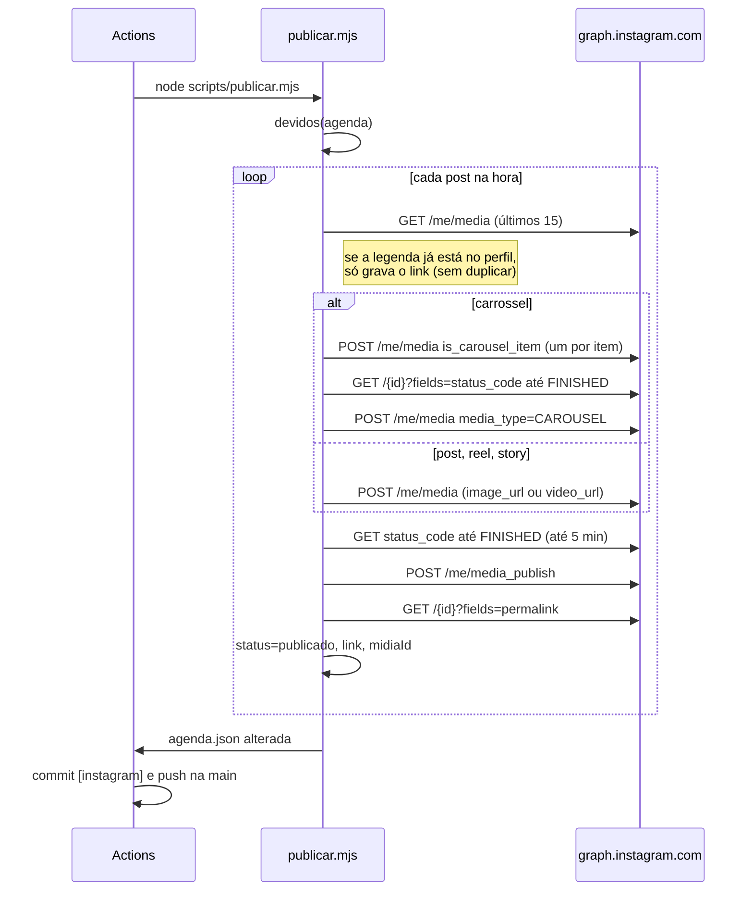

# Publicador

`scripts/publicar.mjs`, chamado pelo workflow **Publicar** (`.github/workflows/publicar.yml`).

## Quando roda

| Gatilho | O que faz |
| --- | --- |
| `schedule: */10 * * * *` | Rodada normal: publica todo post `agendado` cuja hora já passou |
| Botão **Publicar agora** no painel | `workflow_dispatch` com `post=<id>`: publica só esse post, ignorando a hora |
| Actions → Publicar → Run workflow | Manual, com as opções abaixo |

O workflow usa `concurrency: publicar`, então duas rodadas nunca correm ao mesmo tempo.

### Opções do Run workflow

| Entrada | Variável | Efeito |
| --- | --- | --- |
| `post` | `SOMENTE` | Id de um post para publicar agora |
| `simular` | `SIMULAR=1` | Não chama a API. Mostra no log o que publicaria e as URLs de mídia |
| `verificar` | `VERIFICAR=1` | Só confere o token de cada conta e a cota do dia (`token OK, conta @x (MEDIA_CREATOR), cota de hoje 3/100`) |
| `testar_alerta` | `TESTAR_ALERTA=1` | Só manda um e-mail de alerta de exemplo para `ALERTA_EMAIL` |

## O que entra na rodada

Um post entra quando as três condições valem:

1. a conta dele tem `"publicador": "proprio"`;
2. `status` é `agendado` (ou o id é o de `SOMENTE`);
3. `quando` já passou (ou o id é o de `SOMENTE`).

Itens `manual`, `publicado` e `falhou` nunca entram numa rodada normal. Para publicar um
`falhou`, use Publicar agora.

## Como publica



- **URL da mídia:** `https://cdn.jsdelivr.net/gh/leonfpontes/insta_report@<GITHUB_SHA>/instagram/<arquivo>`.
  O commit fixo evita cache velho, e o jsDelivr manda o `Content-Type` certo para vídeo, o que
  o raw do GitHub não faz.
- **Sem post duplicado:** antes de criar o container, o script procura nos últimos 15 posts do
  perfil um com a legenda começando igual (80 primeiros caracteres). Se achar, só grava o link.
  Stories não passam por essa checagem.
- **Container de vídeo:** o script espera até 30 checagens de 10 s. Se o container ficar
  `ERROR` ou `EXPIRED`, conta como falha.

## Falhas

| Situação | Resultado |
| --- | --- |
| Erro da API | `tentativas += 1`, `erro` com a mensagem. Na rodada seguinte tenta de novo |
| 3ª tentativa com erro | `status: "falhou"` e e-mail de alerta |
| Passou mais de `JANELA_HORAS` (6 h) da hora marcada | `status: "falhou"` sem tentar, para não soltar post fora de hora, e e-mail |
| Falta o segredo da conta | Não altera o post; manda e-mail e o workflow termina vermelho |

Se houve falha, o processo sai com código 1 e a rodada aparece vermelha em Actions e na aba
Execuções do painel.

## Variáveis

| Variável | Padrão | Para quê |
| --- | --- | --- |
| `IG_TOKEN_<CONTA>` | | Token de cada conta |
| `RESEND_API_KEY`, `ALERTA_EMAIL` | | E-mail de alerta |
| `AGENDA_ARQUIVO` | `instagram/agenda.json` | Outra agenda, para teste |
| `MIDIA_BASE` | jsDelivr no `GITHUB_SHA`, ou raw da `main` fora do Actions | Base das URLs de mídia |
| `JANELA_HORAS` | `6` | Até quantas horas depois da hora marcada ainda publica |
| `AGORA` | hora atual | Finge outra hora, para teste |
| `SOMENTE`, `SIMULAR`, `VERIFICAR`, `TESTAR_ALERTA` | | Veja as opções do Run workflow |

## Testar sem publicar

```bash
# O que sairia às 19:05 de hoje, sem tocar na API
AGORA=2026-11-04T19:05:00-03:00 SIMULAR=1 node scripts/publicar.mjs
```

No Actions, use Run workflow com o id do post e **simular** marcado. A rodada simulada não grava
nada na agenda.
